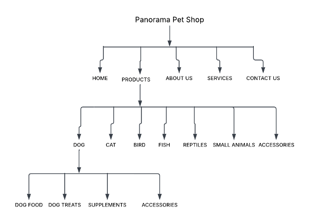
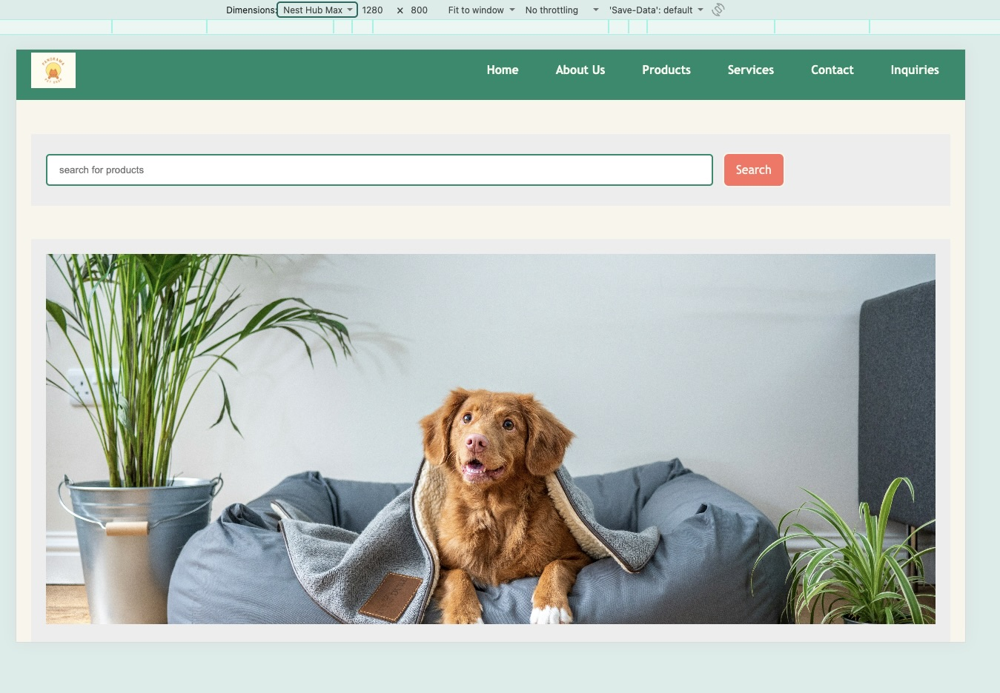
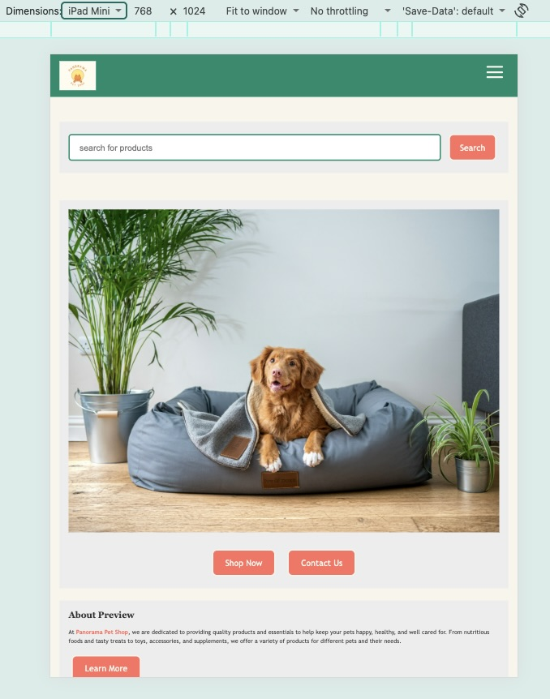
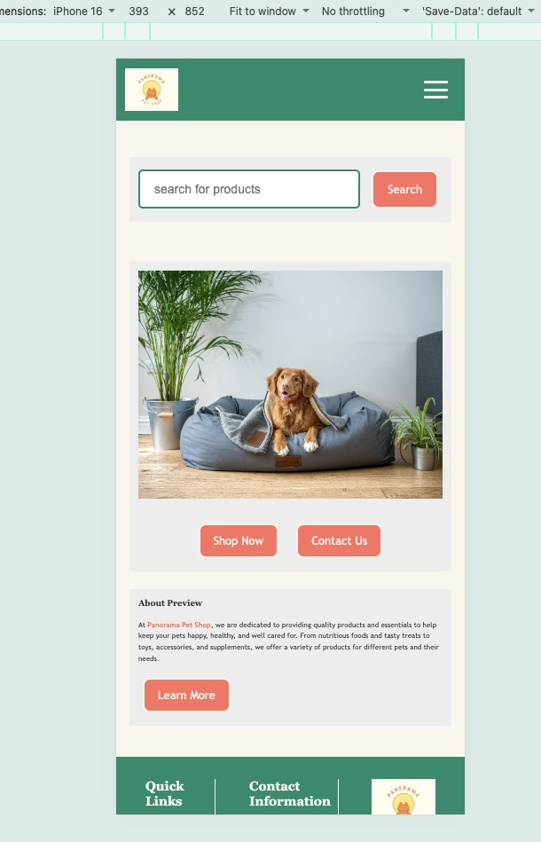
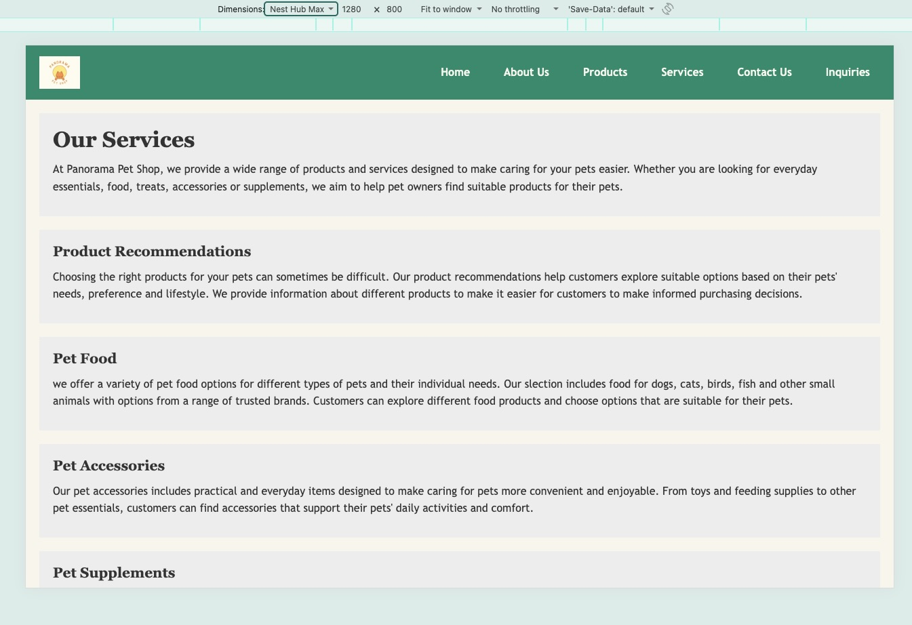
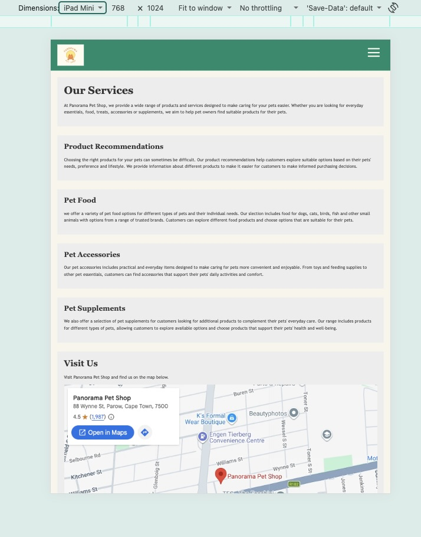
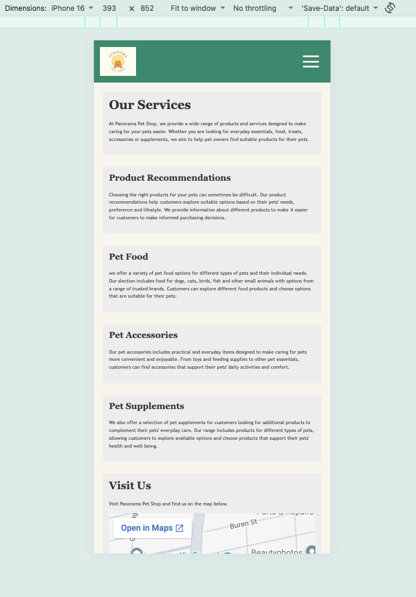
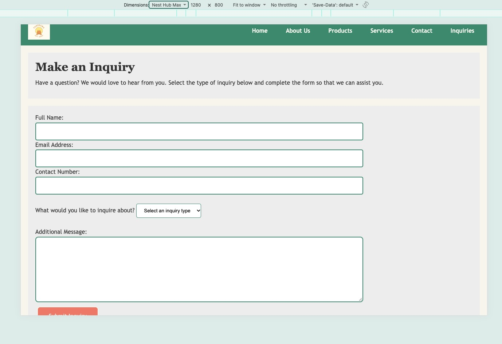
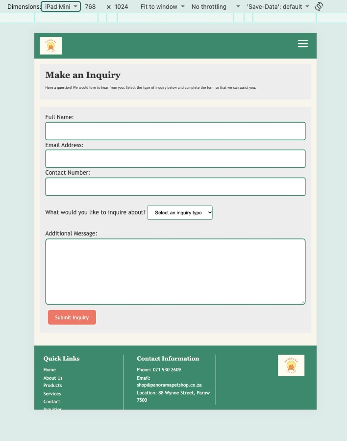
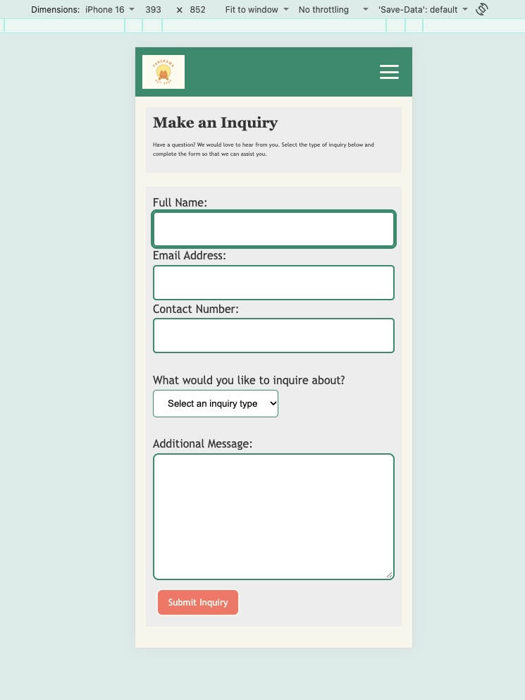

# Panorama_Website

## Student Information
* Student Name: Zusange Mbaleki
* Course: Higher Certificate in Mobile Application and Web Development
* Institution:  Rosebank International
* Project:  Panorama Pet Shop Website

## Project Overview
Panorama Pet Shop is a responsive pet shop website redesign created created for a local pet shop in Parow, Cape Town.The website was designed to provide customers with an easy way to learn about the business, browse available pet products, view services and contact the shop.
The website includes the following pages:
* Home - Introduces Panorama Pet Shop and provides access to the main areas of the website.
* About Us - Provides information about the business and its purpose.
* Products - Organises pet products into different categories, including Dogs, Cats, Birds, Fish, Small Animals, and Accessories.
* Services - Displays the services offered by the pet shop.
* Contact Us - Provides customers with contact and enquiry information.

The website was developed using HTML, CSS, and JavaScript. The design uses an emerald green, coral orange, cream, soft gray, and charcoal colour palette to create a consistent visual identity throughout the website.
The project also includes organised product imagery, category navigation, interactive elements, and responsive design features to improve the overall user experience.

## Website Goals and Objectives
- Improve the website's desktop layout
- Provide clear and intuitive navigation
- Organise products into clear categories
- Provide customers with useful business information
- Improve the overall user experience

## Proposed Key Features and Functionality
- Home page
- About Us page
- Products page
- Services page
- Contact page
- Product categories
- Search functionality
- Responsive design

## Timeline and Milestones
|Date	     |     Milestone  |
|--------------|-------------|
|30 July – 1 August|	Prepare and submit the website draft proposal for feedback and approval.|
|2 – 3 August      |	Review feedback and make any required changes to the proposal.|
|4 – 13 August     |	Develop the basic website structure using HTML.|
|14 August	       |Submit Part 1 (HTML website).|

## Part 1 Details- Project Planning
Part 1 focused on planning and researching the proposed website before development. It requires us to:
* Research and understand the chosen organisation and their existing website.
* Identifying the website's goals, objectives, and target users.
* Identify areas of improvement for the existing website.
* Define the website's required features and content.
* Create a sitemap showing the website's structure and page hierarchy.
* Develop a file and folder structure for the project.
* Create  low-fidelity wireframes for the main pages.
* Research and plan the content, products, and categories.
* Define the proposed design direction, including the colour palette and overall user experience.
* Identify the technical requirements for developing the website.
The Panorama Pet Shop proposal was developed based on these Part 1 requirements and was approved before development began.

## Sitemap
The sitemap below shows the structure and hierarchy of the Panorama Pet Shop website.

## Changelog
### Part 1 Changelog
| Date | Changes |
|---|---|
| 10 August 2026| Created the initisl HTML pages and started the websote structure.|
| 12 August 2026| Added images to the website and organised them according to thier product categories.|
| 13 August 2026| Added the first half of the README. |
| 14 August 2026| Changed the homepage pet image.  Added project reasearch to the README.   Added the sitemap to the README.   Added the project file and folder structure to the README. |

### Part 1 Feedback fixes
| Date | Changes |
|---|---|
| 15 September 2026| Added alt text to images to improve accessibility.  Added more category images as requested in the feeback.   Added comments to the HTML and CSS code to make it easier to understand.   Fixed the Sitemap image and made it visible.|
| 16 September 2026| Added more products and organised them into  categories.   Improved the product card layout and spacing.   Added hover effects to buttons, navigation links, and product cards. |
| 17 September 2026| Improved the Contact Us page by increasing the message box size and updating the Submit button.   Improved the Home page buttons and layout.   Added responsive styling to improve the website on smaller screens.   Updated the footer styling.   improved the overall consistency of the website's colors, layout, and design.|

### Part 2 Feedback fixes
| Date | Feedback point | What I changed | File(s) | Commit message |
|---|---|---|---|---|
| 06 October 2026| Include a CSS reset and include reusable variables.| 1.Added a CSS reset to remove default spacing and make the layout more consistent.  2.Added reuable color varibales to make the colors easier to manage | CSS/styles.css | 1.Added a css reset.   2.Added reusable css variables as instructed on the feedback.|
| 06 October 2026| Avoid using fixed positioning| Fixed the 900px input width and removed the fixed left: 570px button positioning| CSS/styles.css | Improved CSS layout and typography as requested on the part 2 feedback.|
| 06 October 2026| Include visible focus states and an additional 480px breakpoint| Added visible focus states and a 480px breakpoint for smaller mobile screens| CSS/styles.css| Added the 480px breakpoint and visible focus states as requested on part 2 feedback.|
| 27 October 2026| 1.The search bar layout needs improvement on smaller screens to ensure that the search input field and search button displays correctly and remain aligned. | 1. Fixed search bar layout to ensure the search input and search button remain side by side on smaller screens.   2. Improved the responsiveness of the search section for mobile devices. | CSS/styles.css | 1.Improved responsive search layout.|
| 27 October 2026 | Ensure the textarea is responsive and maintains a consistent width. | Improved responsiveness, navigation menu  bar for smaller screens and form styling. | 1. index.html   2. html/About.html   html/Products.html   html/Services.html   HTML/Contact.html   3. CSS/styles.css   4. javascript/script.js | Improved responsiveness, navigation and form styling.|
|29 October 2026 | Include a consistent type scale | Changed the font family of h1, h2, h3, h4 and p throughout the whole website. | CSS/styles.css | Changed the fonts throughout the website for a consistent typography. |
|29 October 2026 | Include a visible state focus | Included the focus state of buttons and added an autofocus on the name input field on the contact page. | CSS/styles.css and html/Contact.html | Updated the focus state of the buttons and  added an autofocus on the contact page 'name' input field. |

### Part 3 Feedback Fixes/Improvements
| Date | Feedback point | What I changed | File(s) | Commit message |
|---|---|---|---|---|
|29 October 2026 | Add category filtering buttons | Added an 'all' button and added category filtering buttons | HTML/Products.html and javascript/script.js | Updated the product category buttons so when the user clicks the 'dog' button it filters the other products and show only the do items. |
|29 October 2026 | Add search functionality | Updated the search field so the user can search items like 'dog supplements' and only show the dog supplements| HTML/Products.html and javascript/script.js| Updated search functionality.|
|01 November 2026| - | Added a logo image to make the navbar a little bit appealing| index.html, HTML/About.html, HTML/Products.html, HTML/Contact.html, HTML/Services.html and MEDIA/home/ | Added the logo image to all the website screens and edited the navbar.|
|01 November 2026| Add search functionality| Added the homepage product search for when the user searches on homepage it will redirect them to the products page and show whatever products is searched| index.html and javascript/script.js| Added homepage product search functionality| 
|01 November 2026| - | Added a new reference 'DESIGN.COM' for the logo image i created.| MEDIA/home/ | Updated part 3 feedback fixes table and added a new reference on the reference list. |
|02 November 2026| Implement elements like accordions, tabs, or modals to enhance user experience.| Added a FAQ section on the Contact page and then styled it in css| HTML/Contact.html and CSS/style.css| Added a FAQ Accordion on the contact page and sstyled it.|
|02 November 2026| Implement elements like accordions, tabs, or modals to enhance user experience.| Added the FAQ Accordion functionality using javascript.| javascript/script.js| Added faq accordion functionality.|
|02 November 2026| Include Google Maps| Embeded Google Maps for the user to see the location of the store.| HTML/About.html and CSS/style.css| Embed a Google Map on the About and made it responsive for different screens using css.|
|02 November 2026| Include a form in both inquiry.html and contact.html| Added the inquiry page and then linked css to it for style. | inquiry.html | Added an inquiry page and updated the nav links and footer links on every page. |
|02 November 2026| Create Sitemap.xml and Robots.txt files | Created the sitemap.xml and robots.txt files. | robots.txt and sitemap.xml | Added robots.txt   Added sitemap.xml |
|02 November 2026 | Add screenshots of the website | Added screenshots of 3 pages in 3 different scren sizes| screenshots/ | Added screenshots images on the readme|

### Part 3 Screenshots of the Webiste in 3 different screens
## Homepage Responsive Design
|Nest Hub Max | iPad Mini | iPhone 16 |
|:---:|:---:|:---:|
|  |  |  |

## Services Responsive design
|Nest Hub Max | iPad Mini | iPhone 16 |
|:---:|:---:|:---:|
|  |  |  |

## Inquiry Responsive Design
|Nest Hub Max | iPad Mini | iPhone 16 |
|:---:|:---:|:---:|
|  |  |  |

## References
Codecademy, 2024. _Markdown Tables_ .[online] Available at: <https://www.codecademy.com/resources/docs/markdown/tables> [Accessed on: 02 November 2026].
DESIGN.COM, 2026. _DESIGN.COM_ .[online] Available at: <https://www.design.com/maker/mylogos/drafts/e923f4f1-8670-43df-990f-f0f8613697a5/editor> [Accessed on: 01 November 2026].
Google Maps, 2026. _Google Maps_ .[online] Available at: <https://www.google.com/maps/@-33.9030213,18.573739,14z?>[Accessed on: 02 November 2026].
Host Africa, 2026. How much does it cost to build a website  in South Africa? (2026 Price Guide).[online] Available at:< https://hostafrica.co.za/blog/websites/website-basics/how-much-does-a-website-cost-in-south-africa/ > [Accessed on: 31 July 2026].
Interaction Design Foundation, [n.d.]. Interaction Design Foundation. [online] Available at: < https://www.interaction-design.org/ > [Accessed on: 30 July 2026].
Mozilla Developer Network (MDN), [n.d.]. CSS Reference. [online] Available at:<https://developer.mozilla.org/en-US/docs/Web/CSS/How_to/Layout_cookbook/Column_layouts> [Accessed on: 17 September 2026].
Smith R., 2017. Validating product Design ideas with low-fidelity wireframes. [online] Available at:<https://medium.com/@robertsmith_co/validating-your-product-design-ideas-with-low-fidelity-wireframes-fba03b84af23 > [Accessed on: 31 July 2026].
Panorama Pet Shop, [n.d.]. Panorama Pet Shop. [online] Available at: < https://panoramapetshop.co.za/product-category/reptiles/ >[Accessed on: 31 July 2026].
W3Schools, [n.d.]. CSS Tutorial. [online] Available at: <https://www.w3schools.com/css/> [Accessed on: 17 September 2026].
Yakushev R., [n.d.]. _Managing Robots.txt and Sitemap files_ . [online] Available at: <https://learn.microsoft.com/en-us/iis/extensions/iis-search-engine-optimization-toolkit/managing-robotstxt-and-sitemap-files> [Accessed on: 02 November 2026].

